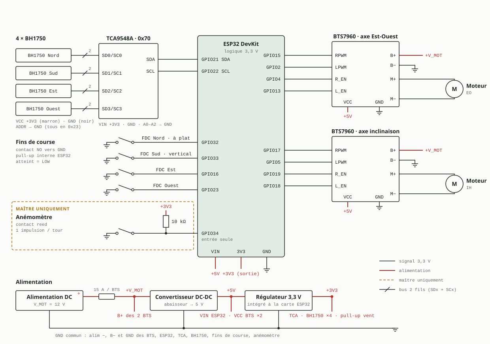
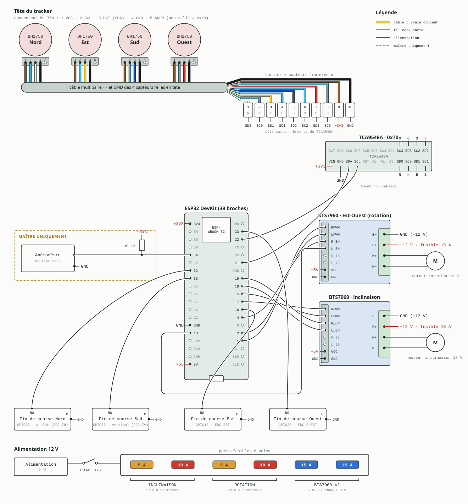
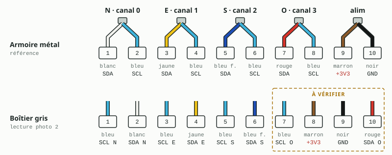
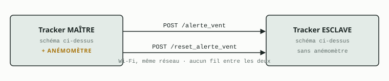

# arduinoTrackSol

Trackeur solaire à 2 axes (Est-Ouest + inclinaison) piloté par ESP32.

## Projet actif : `track_sol_esp32_bts7960_bh1750_mobile/`

Le tracker oriente 4 capteurs de luminosité BH1750 (Nord/Sud/Est/Ouest, via
un multiplexeur I²C TCA9548A) vers le soleil en pilotant deux moteurs
(axe Est-Ouest et axe d'inclinaison) via des drivers BTS7960, avec fins de
course sur chaque axe.

Le système fonctionne en **maître/esclave** sur deux ESP32 : seul le maître
porte un capteur de vent, et notifie l'esclave par HTTP pour mettre les deux
trackers en position de sécurité (à plat) en cas de vent fort, jusqu'à
stabilisation.

### Fonctionnalités

- Tracking automatique basé sur la luminosité (mode AUTO), avec bascule
  manuelle depuis l'interface web (mode MANUEL, arrêt de sécurité si plus de
  commande reçue)
- Mise en sécurité vent (maître) synchronisée sur l'esclave
- Interface web embarquée (contrôle, réglages, journal, code PIN admin)
- Réglages persistés en mémoire flash (`Preferences`)
- Mise à jour du firmware par OTA (Wi-Fi) via ElegantOTA, avec coupure des
  moteurs pendant la MAJ

### Schéma électrique

Les deux trackers ont le même câblage ; seul le maître a l'anémomètre. Les
moteurs sont en 12 V.

**Schéma de principe**

**Vue de câblage** : chaque module est dessiné avec ses broches dans l'ordre
physique, et le câble qui monte à la tête est dessiné avec ses vraies couleurs.

**Bornier « capteurs lumières »** (câble multipaire vers la tête)

| Fil du câble | Rôle |
|---|---|
| blanc / bleu | Nord : SDA / SCL → TCA canal 0 |
| jaune / bleu | Est : SDA / SCL → canal 1 |
| bleu foncé / bleu | Sud : SDA / SCL → canal 2 |
| rouge / bleu | Ouest : SDA / SCL → canal 3 |
| marron | +3V3 des 4 capteurs |
| noir | GND |

Dans chaque paire, le fil de couleur est SDA et le fil bleu est SCL.

**Raccordement ESP32**

| GPIO | Vers | Rôle |
|---|---|---|
| 15 / 2 / 4 / 13 | BTS7960 Est-Ouest : RPWM / LPWM / R_EN / L_EN | moteur de rotation |
| 17 / 5 / 19 / 18 | BTS7960 inclinaison : RPWM / LPWM / R_EN / L_EN | moteur d'inclinaison |
| 21 / 22 | TCA9548A SDA / SCL (0x70) | 4 × BH1750 (0x23) sur les canaux 0 à 3 |
| 32 | Fin de course Nord | inclinaison **à plat**, position de sécurité (`FDC_IH`) |
| 33 | Fin de course Sud | inclinaison **verticale** (`FDC_IV`) |
| 16 | Fin de course Est | butée Est (`FDC_EST`) |
| 23 | Fin de course Ouest | butée Ouest (`FDC_OUEST`) |
| 34 | Anémomètre (maître) | contact reed vers GND + **pull-up 10 kΩ vers 3V3** |

Fins de course : contact NO entre le GPIO et GND (pull-up interne, LOW = butée
atteinte).

**Alimentation** : 12 V → interrupteur I/O → porte-fusibles 6 voies
(5 A, 10 A, 5 A, 10 A, 15 A, 15 A). Les deux 15 A alimentent B+ des BTS7960.
Les voies 5 A et 10 A sont étiquetées INCLINAISON et ROTATION ; leur rôle reste
à documenter.

**Points d'attention**

- GPIO34 n'a pas de pull-up interne : sans la résistance de 10 kΩ, la mesure du
  vent est fausse.
- Masse commune obligatoire entre le 12 V, les BTS7960 et l'ESP32.
- GPIO2, 5 et 15 sont des broches de démarrage : n'y ajouter aucune résistance
  externe.
- Un fil de fin de course coupé n'est pas détecté (câblage NO) : le moteur
  continue de tourner, et la mise à plat (`miseAPlat()`) n'a pas de limite de
  temps.

Liaison entre les deux trackers : Wi-Fi uniquement, aucun fil.

Source des schémas : [`docs/schema-electrique.html`](docs/schema-electrique.html)
(page complète avec les notes, à ouvrir dans un navigateur). Après une
modification, régénérer les images avec `python docs/schema/export_svg.py`.

### Bibliothèques requises (Gestionnaire de bibliothèques Arduino IDE)

- [BTS7960](https://github.com/1337encrypted/BTS7960_Motordriver) — driver moteur
- [BH1750](https://github.com/claws/BH1750) — capteur de luminosité
- [ElegantOTA](https://github.com/ayushsharma82/ElegantOTA) — mise à jour OTA (mode synchrone)
- Inclus dans le core ESP32 : `WiFi`, `WebServer`, `HTTPClient`, `Preferences`, `Wire`

### Mise en route

1. Dans `track_sol_esp32_bts7960_bh1750_mobile/`, copier `config.example.h` →
   `config.h`, `config_master.example.h` → `config_master.h` et
   `config_slave.example.h` → `config_slave.h`.
2. Renseigner le Wi-Fi (`WIFI_SSID`, `WIFI_PASSWORD`) et les pins dans
   `config_master.h`/`config_slave.h`.
3. Dans `config.h`, inclure `config_slave.h` et flasher l'ESP32 esclave en
   premier ; noter son IP (moniteur série).
4. Renseigner cette IP dans `SLAVE_IP` (`config_master.h`), basculer
   `config.h` sur `config_master.h`, puis flasher le maître.
5. Les MAJ suivantes peuvent se faire par OTA (voir `docs/tutoriel-maj-ota-clion.md`).

Voir les commentaires en tête de
`track_sol_esp32_bts7960_bh1750_mobile.ino` pour le détail de chaque module.

## Structure du dépôt

- `track_sol_esp32_bts7960_bh1750_mobile/` — projet actif (ESP32, BTS7960, BH1750, OTA)
- `test/Esp32/` — tests en cours liés au projet actif
- `docs/` — documentation et specs du projet actif (schéma électrique :
  `docs/schema-electrique.html` et images `docs/schema/*.svg`)
- `historique/` — anciennes versions et expérimentations (voir ci-dessous)

### historique/

- `arduino_mega/` — versions pour carte Arduino ATmega2560
  - `track_sol_BTS7960/`, `track_sol_BTS7960_V2/` — versions successives
  - `variantes/` — variantes explorées (L298N, V_UNO, ...)
  - `tests/` — anciens sketchs de test
- `esp32/` — versions et essais ESP32 antérieurs au projet actif
  - `track_sol_ESP32_BTS7960_BH1750/` — première version ESP32
  - `experimentations/` — essais divers
  - `tests/` — anciens sketchs de test